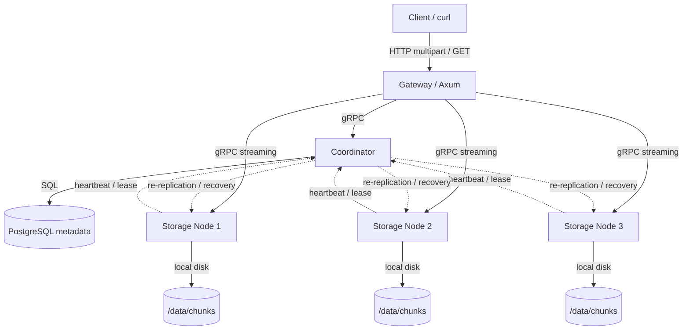
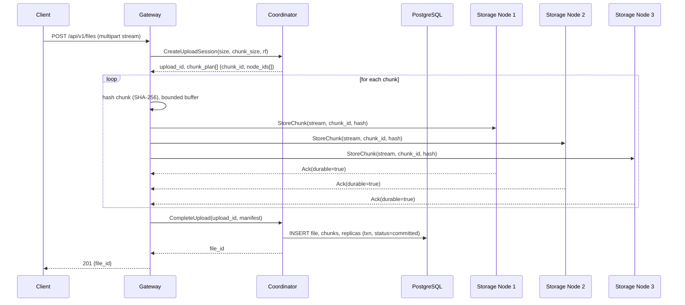
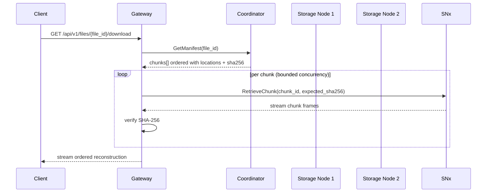
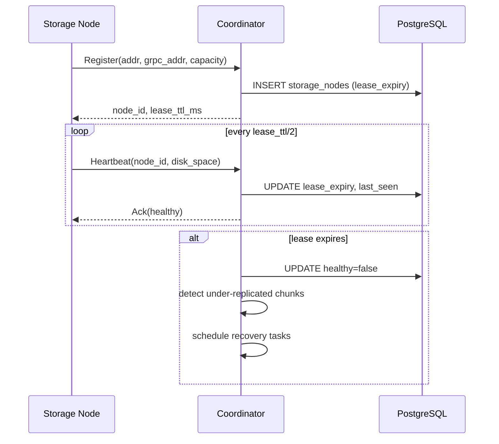
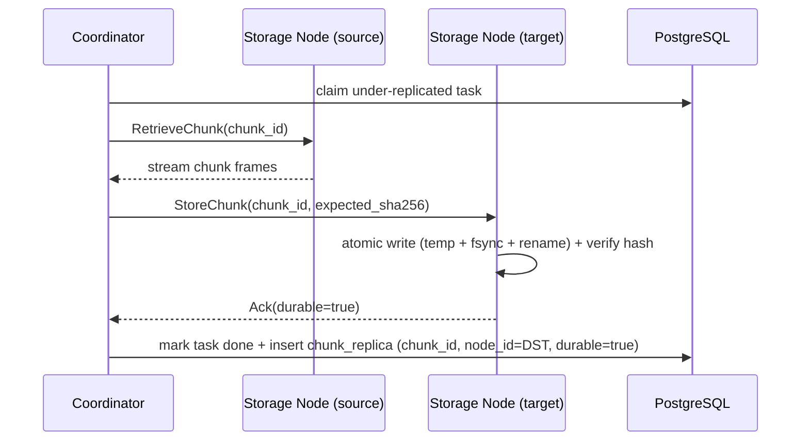

# Architecture

## Overall



## Upload workflow



## Download workflow



## Node registration & heartbeat



## Replication workflow



## Node failure & recovery

```mermaid
flowchart TD
    HB[Heartbeat missed]
    LEASE[Lease expires?]
    UNHEALTHY[Mark node unhealthy]
    DETECT[Detect under-replicated chunks]
    SCHED[Schedule recovery tasks (bounded concurrency)]
    COPY[Copy replica from healthy source node]
    VERIFY[Verify SHA-256 + insert durable replica]
    RF[Replication factor restored]

    HB --> LEASE
    LEASE -- no --> H[Node stays healthy]
    LEASE -- yes --> UNHEALTHY
    UNHEALTHY --> DETECT
    DETECT --> SCHED
    SCHED --> COPY
    COPY --> VERIFY
    VERIFY --> RF
```
